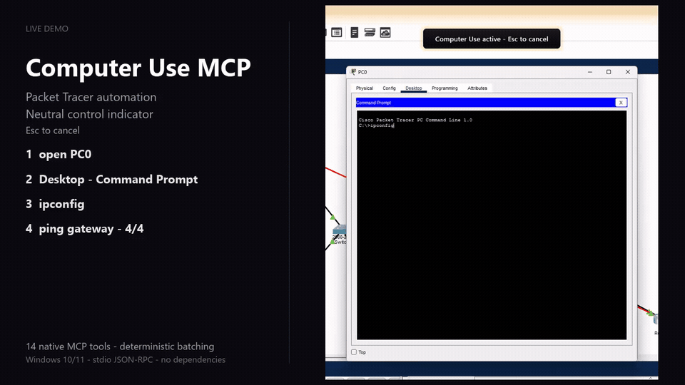

# Computer Use MCP — Native Windows Desktop Automation MCP Server

[](#installation)
[-10B981)](#all-14-native-mcp-tools)
[-F59E0B)](#why-native-windows-mcp)
[](#all-14-native-mcp-tools)
[-blue)](LICENSE)

**Native Windows Computer Use MCP server** for **Claude Code, Claude Desktop, Cursor, Windsurf, VS Code, and Antigravity**. Give AI agents fast, deterministic control over any Windows desktop application—including legacy GUI software without APIs—using WinRT `Windows.Graphics.Capture` occluded screenshots, indexed Windows UI Automation (UIA) trees, server-side 64-step batching (`run_steps`), and a visible control indicator with instant physical `Escape` abort.

> **Zero runtime dependencies:** Connects directly over `stdio` JSON-RPC 2.0 with no Python, `uv`, Node.js, OCR runtime, or IDE required. Agent-facing workflow rules live in [`AGENTS.md`](AGENTS.md) and [`skills/qoder-computer-use/SKILL.md`](skills/qoder-computer-use/SKILL.md).

---

## Table of Contents

- [Live Demo (Cisco Packet Tracer)](#live-demo)
- [Why Native Windows MCP?](#why-native-windows-mcp)
- [Installation (Claude Code, Claude Desktop, Cursor, VS Code, Windsurf, Antigravity)](#installation)
- [All 14 Native MCP Tools](#all-14-native-mcp-tools)
- [Example: Single-Call `run_steps` Batch](#example-single-call-run_steps-batch)
- [Control Indicator & Security](#control-indicator--security)
- [Repository Layout](#repository-layout)
- [FAQ & Troubleshooting](#faq--troubleshooting)
- [Roadmap](#roadmap)

---

## Live Demo

[](demo/computer-use-demo.mp4)

The recording shows the MCP server driving **Cisco Packet Tracer** (a native desktop GUI app with no automation API):

1. Discovers and activates the open `packet-tracer-demo.pkt` window.
2. Double-clicks **PC0** using window-relative screenshot coordinates.
3. Navigates to **Desktop → Command Prompt** inside the device window.
4. Runs `ipconfig` and `ping 192.168.10.1`, capturing **4/4 replies** while displaying the neutral amber control indicator (`Esc to cancel`).

- [Watch the full 30-second HD demo (`demo/computer-use-demo.mp4`)](demo/computer-use-demo.mp4)
- Inspect the automation client ([`demo/demo.mjs`](demo/demo.mjs)) and network topology ([`demo/packet-tracer-demo.pkt`](demo/packet-tracer-demo.pkt))

To re-record locally (requires Windows 10/11, Node.js, `ffmpeg`, and Cisco Packet Tracer 9.0.1):

```powershell
powershell -ExecutionPolicy Bypass -File demo/record-demo.ps1
```

*(Adjust `$packetTracer` inside [`demo/record-demo.ps1`](demo/record-demo.ps1) if Packet Tracer is installed at a different path.)*

---

## Why Native Windows MCP?

Most Windows desktop automation MCP servers wrap Python (`PyAutoGUI` / `pywinauto` / RapidOCR) or Node.js (`nut.js`), requiring runtime environments, full-screen focus, and multiple LLM round-trips per click. Connecting directly to a native compiled Windows MCP server changes the performance and reliability profile:

| Capability | Native Windows Computer Use MCP | Typical Python / Node Wrappers |
| :--- | :--- | :--- |
| **Runtime Dependencies** | None — single Windows x86_64 executable | Python + `uv` + OCR models or Node.js + native addons |
| **Occluded Window Capture** | 3-tier fallback: isolated WinRT `Windows.Graphics.Capture` (compositing transient popups/menus) → GDI `PrintWindow` → screen `BitBlt` | Full-display screenshots requiring foreground focus |
| **Multi-Step Batching** | Built-in `run_steps` server-side orchestrator (1–64 steps) with auto-hydrated revisions & final-state polling | 1 LLM round-trip per mouse click or keystroke |
| **Action + Refresh in One Call** | Every mutating tool supports `post_action_state: true` to return a fresh screenshot/UIA tree in the same call | Separate `act` then `observe` round-trips |
| **Semantic UIA Filtering** | Server-side `state_tree_filter`, `state_max_tree_lines`, and `element_text` matching trim huge Electron/Chromium trees before reaching the LLM | Full raw accessibility tree or OCR-only coordinate guessing |
| **User Safety & Abort** | Visible neutral dark status card + amber screen-edge glow + physical `Escape` abort (`user_interrupted`) | Typically no visual indicator or hardware interrupt |

---

## Installation

**Requirements:** Windows 10 or Windows 11 (`x86_64`) inside an interactive desktop session (not a headless Windows Service).

### 1. Antigravity (Global Plugin)

Clone into `%USERPROFILE%\.gemini\config\plugins\qoder-computer-use` and run [`install.ps1`](install.ps1) to bind your local binary path in `mcp_config.json`:

```powershell
git clone https://github.com/efaz1401/computer-use-mcp.git "$env:USERPROFILE\.gemini\config\plugins\qoder-computer-use"
powershell -ExecutionPolicy Bypass -File "$env:USERPROFILE\.gemini\config\plugins\qoder-computer-use\install.ps1"
```

### 2. Claude Code CLI

```powershell
git clone https://github.com/efaz1401/computer-use-mcp.git "$env:USERPROFILE\.mcp\computer-use-mcp"
claude mcp add --scope user computer-use -- "$env:USERPROFILE\.mcp\computer-use-mcp\bin\QoderComputerUse.exe"
```

### 3. Claude Desktop

Add the server to `%APPDATA%\Claude\claude_desktop_config.json` (replace `<YOUR_USERNAME>` with your Windows account name) and restart Claude Desktop:

```json
{
  "mcpServers": {
    "computer-use": {
      "command": "C:\\Users\\<YOUR_USERNAME>\\.mcp\\computer-use-mcp\\bin\\QoderComputerUse.exe",
      "args": [],
      "env": {
        "QODER_CUA_OPERATION_OVERLAY": "1",
        "QODER_CUA_POINTER_ANIMATION": "0",
        "QODER_CUA_LOG_LEVEL": "warn"
      }
    }
  }
}
```

### 4. Cursor / Windsurf / VS Code (`mcp.json`)

Add the same configuration block to:
- **Cursor:** `.cursor/mcp.json` (project) or `%USERPROFILE%\.cursor\mcp.json` (global)
- **VS Code:** `.vscode/mcp.json`
- **Windsurf:** `%USERPROFILE%\.codeium\windsurf\mcp_config.json`

```json
{
  "mcpServers": {
    "computer-use": {
      "command": "C:\\Users\\<YOUR_USERNAME>\\.mcp\\computer-use-mcp\\bin\\QoderComputerUse.exe",
      "args": [],
      "env": {
        "QODER_CUA_OPERATION_OVERLAY": "1",
        "QODER_CUA_POINTER_ANIMATION": "0",
        "QODER_CUA_LOG_LEVEL": "warn"
      }
    }
  }
}
```

---

## All 14 Native MCP Tools

Complete JSON input/output schemas are documented in [`docs/tools-schema.json`](docs/tools-schema.json). Detailed agent rules live in [`skills/qoder-computer-use/SKILL.md`](skills/qoder-computer-use/SKILL.md).

| Tool | Purpose | Key Capabilities |
| :--- | :--- | :--- |
| `list_apps` | Discover running & recent apps | Queries running apps + 14-day recent apps (`UserAssist`, Start Menu, `App Paths`, `shell:AppsFolder`) |
| `list_windows` | Enumerate top-level windows | Returns targetable desktop windows in Z-order with optional bounds and minimized state |
| `get_window` | Rehydrate a window handle | Validates and refreshes a previously returned `{ app, id }` window object |
| `launch_app` | Start a Windows application | Launches by catalog ID, AUMID, or `.exe` path with optional `wait_for_window` |
| `activate_window` | Foreground a target window | Restores minimized windows, brings to front, and supports `post_action_state` |
| `get_window_state` | Observe screenshot and/or UIA tree | WinRT `Windows.Graphics.Capture` screenshot + indexed UIA accessibility tree, focused element & selection |
| `click` | Mouse click or UIA invoke | Window-relative screenshot pixels `(x, y)` or semantic UIA `element_index` (`left`/`right`/`middle`, multi-click) |
| `drag` | Drag-and-drop | Drags between two window-relative screenshot coordinates with configurable `duration_ms` |
| `scroll` | Scroll inside a window | Horizontal/vertical wheel scrolling at window-relative `(x, y)` |
| `press_key` | Send key or hotkey chord | X11 keysyms & `+`-joined chords (e.g., `Return`, `Control_L+a`, `Alt_L+F4`); rejects `Windows`/`Meta`/`Super` |
| `type_text` | Type Unicode text | Literal text entry via `SendInput` / clipboard paste with optional `verify_text` |
| `set_value` | Set editable UIA control value | Direct `ValuePattern` / `LegacyIAccessiblePattern` assignment without visual focus |
| `perform_secondary_action` | Trigger secondary UIA actions | Invokes `Raise`, `Expand`, `Collapse`, `Scroll Up/Down/Left/Right` on indexed elements |
| `run_steps` | Server-side batch orchestrator | Runs 1–64 steps with auto-hydration, semantic `element_text` lookup, `state_tree_filter`, and `final_state_expect_text` polling |

---

## Example: Single-Call `run_steps` Batch

Instead of making 8 separate MCP tool calls to open Notepad, focus the editor, type text, and confirm the result, `run_steps` executes and verifies the workflow in one request:

```json
{
  "target": {
    "source": "list_apps",
    "app_filter": "Notepad",
    "launch_if_missing": true,
    "activate": "auto"
  },
  "steps": [
    { "tool": "click", "arguments": { "element_text": "RichEditD2DPT" } },
    { "tool": "type_text", "arguments": { "text": "Hello from native Windows Computer Use MCP!" } },
    { "tool": "press_key", "arguments": { "key": "Return" } }
  ],
  "final_state": true,
  "final_state_include_screenshot": true,
  "final_state_include_text": true,
  "state_tree_filter": ["RichEdit", "Document"]
}
```

---

## Control Indicator & Security

- **Always-Visible Control Indicator:** Keep `QODER_CUA_OPERATION_OVERLAY=1` enabled. While the AI is acting, Windows displays a neutral dark status card with an amber screen-edge glow, and hides it automatically when control ends. Pointer animation stays off (`QODER_CUA_POINTER_ANIMATION=0`).
- **Instant Hardware Abort:** Press physical **`Escape`** at any time to immediately halt automation (`user_interrupted`).
- **Customize Label (1–95 UTF-8 bytes):**
  ```powershell
  powershell -ExecutionPolicy Bypass -File tools/set-indicator.ps1 -Text "Computer Use active - Esc to cancel"
  ```
- **Security Policy & Binary Verification:** Read [`SECURITY.md`](SECURITY.md) for the full threat model, indirect prompt-injection guardrails, restricted OS dialogs, SHA-256 verification hash, and open-source Rust rewrite status.

---

## Repository Layout

```text
computer-use-mcp/
├── README.md                              # Project overview, setup guides, tool reference, FAQ
├── AGENTS.md                              # Agent-facing workflow & safety instructions
├── LICENSE                                # MIT License (repo tooling, skills, schemas & docs)
├── SECURITY.md                            # Threat model, guardrails, binary verification & disclosure
├── plugin.json                            # Antigravity plugin manifest
├── mcp_config.json                        # Antigravity MCP server config template
├── install.ps1                            # Windows setup script binding absolute binary path
├── bin/
│   └── QoderComputerUse.exe               # Native Windows x86_64 stdio MCP server (v2.2.16)
├── skills/
│   └── qoder-computer-use/
│       └── SKILL.md                       # Universal 14-tool agent skill
├── docs/
│   └── tools-schema.json                  # Complete JSON schemas for all 14 native MCP tools
├── tools/
│   └── set-indicator.ps1                  # Neutral control indicator label/theme tool
├── demo/
│   ├── computer-use-demo.gif              # Animated README preview
│   ├── computer-use-demo.mp4              # 30-second Cisco Packet Tracer demo recording
│   ├── packet-tracer-demo.pkt             # Packet Tracer network topology
│   ├── demo.mjs                           # MCP JSON-RPC client driving the demo
│   └── record-demo.ps1                    # Reproducible ffmpeg screen-capture script
└── assets/
    └── logo.svg                           # Plugin icon
```

---

## FAQ & Troubleshooting

### Does this Windows Computer Use MCP server require Python or Node.js?
No. Running the MCP server itself requires no Python, `uv`, Node.js, or external OCR engine. Node.js and `ffmpeg` are only needed if you choose to run the optional `demo/record-demo.ps1` script.

### Can it inspect or interact with occluded (background) Windows apps?
Yes. `get_window_state` uses WinRT `Windows.Graphics.Capture` (with GDI `PrintWindow` and screen `BitBlt` fallbacks) so it can capture windows covered by other apps. Keyboard actions and semantic UIA calls (`set_value`, `element_index`) can also reach occluded windows, while pointer clicks that encounter occlusion report `target_occluded` so the agent can call `activate_window` and re-observe.

### Why are `click`, `drag`, and `scroll` coordinates window-relative instead of full-screen?
Every coordinate `(x, y)` maps directly to the returned window screenshot's `width × height` pixels (`0 <= x < width`, `0 <= y < height`). This prevents multi-monitor offset bugs and keeps coordinate accuracy stable across DPI scaling when hosts scale coordinates using the returned `coordinateGuidance`.

### How do I stop the AI agent immediately while it is controlling my desktop?
Press the physical **`Escape`** key while the amber control indicator is active. The server immediately aborts the active action and returns `user_interrupted` to the MCP host.

### Does it work with Claude Code, Claude Desktop, Cursor, Windsurf, and VS Code?
Yes. Because it speaks standard **Model Context Protocol (MCP) over `stdio` JSON-RPC 2.0**, any Windows MCP client can connect directly using the JSON configurations in the [Installation](#installation) section above.

### What is the open-source roadmap for the server executable?
Original tooling, skills, schemas, and documentation in this repository are MIT-licensed. The roadmap prioritizes replacing the bundled precompiled `bin/QoderComputerUse.exe` with a 100% open-source native Rust Windows UIA + WinRT `Windows.Graphics.Capture` implementation built transparently in GitHub Actions with checksummed releases, `winget`/`scoop` packages, and Official MCP Registry (`server.json`) publishing.

---

## Roadmap

- [ ] **Open-Source Native Rust Engine:** Clean-room MIT/Apache-2.0 Rust implementation (`windows-rs`, WinRT `Windows.Graphics.Capture`, Windows UI Automation, `run_steps` batch engine) compiled via GitHub Actions with SHA-256 release artifacts.
- [ ] **Official MCP Registry & Package Managers:** Publish `server.json` to `modelcontextprotocol/registry`, plus 1-command installs via `winget`, `scoop`, and `npx`.
- [ ] **Reproducible Latency & Token Benchmarks:** Publish open benchmarks comparing native Rust + `run_steps` batching against Python/PyAutoGUI Windows MCP servers.
- [ ] **Dedicated Documentation Site:** Searchable tool schema playground, per-client guides, and legacy desktop automation tutorials.
