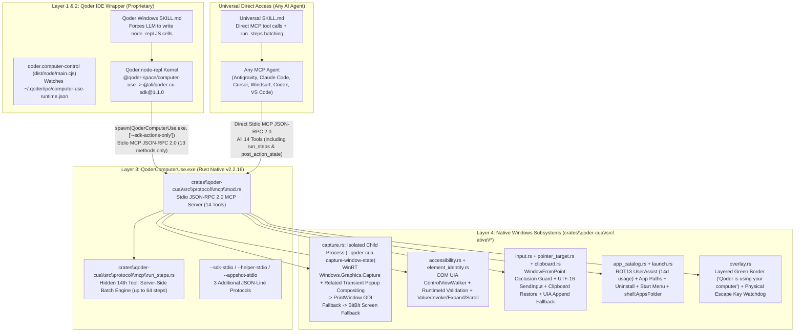

# Reverse Engineering Qoder Computer Use with REA

> [!IMPORTANT]
> **Headline Discovery:** Qoder's `SKILL.md` claims that Computer Use can only be called through Qoder's internal `node_repl` JavaScript runtime (`@qoder-space/computer-use`) and warns *"Do not spawn the helper executable."*
> Static and protocol analysis with **REA (`reverse-engineer-anything`)** proves that the underlying native Rust binary—[`QoderComputerUse.exe`](file:///C:/Users/MSI/.qoder/bin/qoder-computer-use/QoderComputerUse.exe) (`v2.2.16`)—**is itself a standalone, zero-dependency, standard stdio MCP server** (`protocolVersion: "2024-11-05"` through `"2026-07-28"`) that exposes **14 native MCP tools** (including a hidden server-side batch orchestrator, `run_steps`, and single-round-trip `post_action_state` flags that Qoder's JS SDK stripped out).

A portable, drop-in universal skill file has been generated at [SKILL.md](file:///C:/Users/MSI/.gemini/antigravity/brain/d1f6a164-7691-4d5b-8209-bd7d0b6e9ea5/SKILL.md), and the complete REA Evidence bundle (36 records) is archived at [qoder-computer-use-rea-evidence.json](file:///C:/Users/MSI/.gemini/antigravity/brain/d1f6a164-7691-4d5b-8209-bd7d0b6e9ea5/qoder-computer-use-rea-evidence.json).

---

## 1. Architecture Overview (4 Layers)



---

## 2. REA Evidence Ledger

Every finding below is backed by a deterministic REA Evidence record stored in [qoder-computer-use-rea-evidence.json](file:///C:/Users/MSI/.gemini/antigravity/brain/d1f6a164-7691-4d5b-8209-bd7d0b6e9ea5/qoder-computer-use-rea-evidence.json):

| Target Artifact | SHA-256 Digest | REA Operation | Evidence ID | Authority / Confidence | Key Findings |
| :--- | :--- | :--- | :--- | :--- | :--- |
| [`QoderComputerUse.exe`](file:///C:/Users/MSI/.qoder/bin/qoder-computer-use/QoderComputerUse.exe) (`2,624,496` B, v2.2.16) | `cd9b377268e17f1b04ce0f8d5efa2604b2cd167e784ccddc7ec4be9e2e764027` | `inspect_pe_imports` | `ev_0e502fcaea398bc8113817d283ef857ee34fb65003917655c275dbaaed144571` | `shipped-artifact` / `observed` | PE32+ x86_64, 21 DLLs, 240 imports (`imphash: 9d280b45c4f0f6cb266804bc58ac9105`). Imports `D3D11CreateDevice`, `CreateDirect3D11DeviceFromDXGIDevice` (`d3d11.dll`), `RoGetActivationFactory` (`api-ms-win-core-winrt-l1-1-0.dll`), `PrintWindow`, `SendInput`, `UpdateLayeredWindow`, `WindowFromPoint`, `GetAsyncKeyState` (`user32.dll`), `DwmGetWindowAttribute` (`dwmapi.dll`), `CoCreateInstance` (`ole32.dll`), `RegQueryValueExW` (`advapi32.dll`), `SHGetKnownFolderItem` (`shell32.dll`). |
| [`QoderComputerUse.exe`](file:///C:/Users/MSI/.qoder/bin/qoder-computer-use/QoderComputerUse.exe) | `cd9b3772...` | `inspect_rust_binary` | `ev_9703941c4d2f5a664e7ea5ac65d5c398e527b9b9408512fbf9fec36a2d640e23` | `shipped-artifact` / `observed` | Rust executable compiled from `rustc` commit `48a229ceaefd4985c50990b14116b6d856af0985` (file offset `2011552`); `.dep-v0` section omitted. |
| [`QoderComputerUse.exe`](file:///C:/Users/MSI/.qoder/bin/qoder-computer-use/QoderComputerUse.exe) | `cd9b3772...` | `audit_release_exposure` | `ev_2282bc929ab248f509bbc032a7ff99edf29a8b39d45d597b68ab4159de6f290d` | `shipped-artifact` / `observed` | Exposes CodeView PDB path `"qoder_computer_use_windows.pdb"`. |
| [`QoderComputerUse.exe`](file:///C:/Users/MSI/.qoder/bin/qoder-computer-use/QoderComputerUse.exe) | `cd9b3772...` | `inspect_pe_certificates` | `ev_e12639c10c40451399d31504cf858451a34ce966b7b85c405e067f4900553c3d` | `shipped-artifact` / `observed` | PKCS#7 signedData at offset `2609664` (`14,832` B); leaf X.509 certificate issued to `BRIGHT ZENITH PRIVATE LIMITED` (Singapore, reg `202416120Z`, serial `2e4ed0a5654c00e20927f94c`) by `GlobalSign GCC R45 EV CodeSigning CA 2020`. |
| [`QoderComputerUse.exe`](file:///C:/Users/MSI/.qoder/bin/qoder-computer-use/QoderComputerUse.exe) | `cd9b3772...` | `inspect_binary_hardening` & `inspect_pe_load_config` | `ev_b2f26c5fe8513e3e5a5e65a206feff2b32a2608dea5b3b2643bc8d4610802a0b`, `ev_4cef4af9c175eb7f63fe1afa0afc9b6345a25842d9a71035d1675559e7f09079` | `shipped-artifact` / `observed` | `dynamic_base`, `high_entropy_va`, `nx_compat`, `authenticode_present`, `debug_record_present` enabled; `IMAGE_GUARD_CF_INSTRUMENTED` flag set in Load Config (`size: 320` at offset `2170896`). |
| [`QoderComputerUse.exe`](file:///C:/Users/MSI/.qoder/bin/qoder-computer-use/QoderComputerUse.exe) | `cd9b3772...` | `inspect_byte_entropy` | `ev_e0f37301853a14bed1eb27a2b0b74a2be3068cc38a7b1dc7bfb4087ada07ffca` | `shipped-artifact` / `derived` | File-wide Shannon entropy `6.3025` across 641 4-KiB blocks (unpacked native code; only 2 high-entropy runs corresponding to the PKCS#7 certificate table at `2609152` and read-only lookup tables at `2121728`). |
| [`33ddbe5f...zip`](file:///C:/Users/MSI/AppData/Local/Programs/Qoder/resources/bundled-resources/archives/qoder-computer-use/33ddbe5f3283227a5742ac27d1f78d5ea77ab7c10e7686aa9d1d75a22401e4ed.zip) | `33ddbe5f3283227a5742ac27d1f78d5ea77ab7c10e7686aa9d1d75a22401e4ed` | `inspect_artifact` | `ev_58b2a98473576472e4a34338df9af04eb184b41632445f8bdc15723229c90731` | `shipped-artifact` / `observed` | Bundled fallback archive in `resources/bundled-resources/archives/qoder-computer-use/` containing `qoder-computer-use/QoderComputerUse.exe` (`v2.2.13`, `2,530,288` B, SHA-256 `6eb22eb4a6c73928919ecd30f11d41bacf3d5f432c773e8e81f2898e71e24919`). |
| [`@ali/qoder-cu-sdk`](file:///C:/Users/MSI/AppData/Local/Programs/Qoder/resources/node-repl/node_modules/@ali/qoder-cu-sdk) (`v1.1.0`) | `ccf1117c5219afb3dabec932215c1069beb846883c7efbb3febeaad938bb44ac` | `analyze_javascript_application` & `trace_javascript_semantics` | `ev_674e0a16ca4abd966880b2f2b27de52cc83d654fd6c316f0ff3a5b711d991fc1`, `ev_74e117f9302c03f63359ac17e04136368f843ee506a6743e44e97fe57a2ea2b7` | `shipped-artifact` / `observed` & `inferred` | 38 JS/d.ts files (`108,764` B). `WindowsComputerUse.create` (`dist/src/windows/windowsComputerUse.js:18-36`) reads `options.binaryPath ?? process.env.QODER_CU_BINARY_PATH` and calls `WindowsTransport.connect`, which spawns `QoderComputerUse.exe --sdk-actions-only` as a stdio MCP server. |
| [`qoder.computer-control`](file:///C:/Users/MSI/AppData/Local/Programs/Qoder/resources/extensions/qoder.computer-control) (`v1.0.0`) | `576f63f66e7bb916a292d05cf3801202b208a6eee3a3f52ecb058b48dad60633` | `analyze_javascript_application` & `trace_javascript_semantics` | `ev_825e6006552ae790f699e31e61cbdd99f9e59b03124d32aea4633a2d91773f56`, `ev_bc61098b7e3bfd6d8b3bfc332e49398e710c31d34f527fc61e429d2d9c459ae7` | `shipped-artifact` / `observed` & `inferred` | Contains platform skills (`computerUseWindows`, `computerUseMacOS`, `computerUseLinux`, `recordAndReplay`, `browserUse`) plus `dist/node/main.cjs` (`ComputerUseRuntimeConnection` at line 279 watching `~/.qoder/ipc/computer-use-runtime.json`). |

---

## 3. Inside `QoderComputerUse.exe` (`crates\qoder-cua`)

### 3.1 Recovered Rust Source Tree (27 Modules)

From embedded panic/tracing locations in `.rdata`, the complete source tree of `QoderComputerUse.exe` is:

- **Core & Lifecycle:**
  - `crates\qoder-cua\src\main.rs` — CLI argument dispatcher & stdio mode router
  - `crates\qoder-cua\src\runtime.rs` — Tool execution engine, timing metrics, and turn-context enforcement
  - `crates\qoder-cua\src\state.rs` — Per-session `snapshotRevision`, `screenshotId`, `accessibilityRevision`, and window cache
  - `crates\qoder-cua\src\errors.rs` — Structured error codes (`retry`, `refetch`, `diagnostics`)
  - `crates\qoder-cua\src\logging.rs` — Asynchronous log writer (`qoder-cua-log-writer`) with PII redaction (`<redacted:...>`) and automatic log compaction
- **Protocol Layer (`crates\qoder-cua\src\protocol\*`):**
  - `crates\qoder-cua\src\protocol\mod.rs`
  - `crates\qoder-cua\src\protocol\mcp\mod.rs` — Native JSON-RPC 2.0 MCP server (`initialize`, `notifications/initialized`, `tools/list`, `tools/call`)
  - `crates\qoder-cua\src\protocol\mcp\schema.rs` — JSON schemas for all 14 MCP tools
  - `crates\qoder-cua\src\protocol\mcp\content.rs` — Dual MCP response builder (`content[]` text + base64 PNG image blocks + `structuredContent` envelope)
  - `crates\qoder-cua\src\protocol\mcp\run_steps.rs` — Server-side multi-step batch execution engine (`run_steps`)
  - `crates\qoder-cua\src\protocol\mcp\telemetry.rs` — MCP call telemetry
  - `crates\qoder-cua\src\protocol\helper\mod.rs` — Legacy `--helper-stdio` protocol
  - `crates\qoder-cua\src\protocol\helper\sdk.rs` — Direct `--sdk-stdio` protocol
- **Native Windows Layer (`crates\qoder-cua\src\native\*`):**
  - `crates\qoder-cua\src\native\capture.rs` — 3-tier screenshot engine: isolated child-process WinRT `Windows.Graphics.Capture` (`Direct3D11CaptureFramePool.CreateFreeThreaded`) + transient child/popup window compositing (`compositedRelatedTransientCount`) → GDI `PrintWindow` fallback (`rust-gdi-printwindow-fallback`) → screen `BitBlt` fallback (`gdi-bitblt-screen-fallback`)
  - `crates\qoder-cua\src\native\accessibility.rs` — COM UI Automation (`IUIAutomation`, `ControlViewWalker`) tree extractor with `CenterPoint`, `ValuePattern`, `InvokePattern`, `ExpandCollapsePattern`, `ScrollPattern`, `LegacyIAccessiblePattern`
  - `crates\qoder-cua\src\native\element_identity.rs` & `sdk_elements.rs` — Snapshot-scoped element indexing & `RuntimeId` validation
  - `crates\qoder-cua\src\native\input.rs` — Win32 `SendInput` mouse/keyboard synthesis, optional pointer animation (`cursorMoveFrames`), X11 keysym chord parser, and 3-tier `type_text` (`unicode-sendinput` → `rust-clipboard-paste` → `uia-value-append-fallback`)
  - `crates\qoder-cua\src\native\pointer_target.rs` — Pre-click `WindowFromPoint` occlusion verification (`target_occluded`)
  - `crates\qoder-cua\src\native\clipboard.rs` — Transactional Unicode clipboard manager that snapshots and restores prior clipboard contents (`restored_unicode_text` / `cleared_after_no_prior_unicode_text`)
  - `crates\qoder-cua\src\native\app_catalog.rs` & `app_catalog_identity.rs` — Multi-source application discovery combining live processes, ROT13-decoded `UserAssist` registry usage stats (14-day window), `App Paths`, `Uninstall` registry, Start Menu `.lnk` shortcuts, `%LOCALAPPDATA%\Microsoft\WindowsApps`, and `shell:AppsFolder`
  - `crates\qoder-cua\src\native\window_registry.rs` — DPI-aware (`SetThreadDpiAwarenessContext`) `EnumWindows` and DWM frame-bounds resolver
  - `crates\qoder-cua\src\native\launch.rs` & `launchErrors.rs` — Multi-method launcher (`IApplicationActivationManager::ActivateApplication` → `ShellExecuteExW` → `CreateProcessW`)
  - `crates\qoder-cua\src\native\overlay.rs` — Layered green border & status banner (`"Qoder is using your computer"`) with physical `Escape` key interrupt polling
  - `crates\qoder-cua\src\native\appshot.rs` — Streaming window capture service (`--appshot-stdio`)

---

### 3.2 All 9 CLI Flags (Decoded from `.text` 64-bit Immediates & `.rdata` SIMD Constants)

Disassembling `crates\qoder-cua\src\main.rs` (`RVA 0x1291ca..0x12a784`) revealed that LLVM compiled several flag checks as 8-byte `movabs` immediates and overlapping 16-byte SSE2 `pcmpeqb` vectors:

| CLI Flag | Mode / Behavior |
| :--- | :--- |
| *(no arguments)* | **Starts the native Rust MCP server over stdio** (exposes all 14 tools). |
| `--sdk-actions-only` | Checked at `RVA 0x12a06b` via `args.skip(1).all(\|a\| a == "--sdk-actions-only")`. Identical to no-argument MCP mode; exists so `@ali/qoder-cu-sdk` can pass `--sdk-actions-only` when spawning the child process. |
| `--version` | Checked at `RVA 0x1291ca`; prints `qoder-computer-use-windows 2.2.16` and exits. |
| `--sdk-stdio` | Checked at `RVA 0x1295aa`; runs the lightweight JSON-line SDK RPC loop (`crates\qoder-cua\src\protocol\helper\sdk.rs`). |
| `--helper-stdio` | Checked at `RVA 0x12941a`; runs the legacy helper JSON-line RPC loop (`crates\qoder-cua\src\protocol\helper\mod.rs`). |
| `--appshot-stdio` | Checked at `RVA 0x12931a`; runs the streaming Appshot capture server (`startAppshotCapture`, `startFrontmostAppshotCapture`, `nextAppshotCaptureUpdate`, `cancelAppshotCapture`). |
| `--qoder-cua-capture-window-state <path>` | Internal child-process mode spawned during isolated WinRT `Windows.Graphics.Capture` (`QODER_CUA_CAPTURE_CHILD=1`) so GPU/driver crashes never take down the MCP server. |
| `--qoder-cua-apps-folder-catalog <path>` | Internal child-process mode spawned to enumerate `shell:AppsFolder` UWP/packaged apps out-of-process. |
| `--qoder-cua-self-test-overlay` / `--qoder-cua-self-test-clipboard` | Internal diagnostic self-tests for the green layered overlay (`CAPTUREBLT` pixel sampling) and clipboard save/restore. |

---

### 3.3 All 29 `QODER_CUA_*` Environment Variables

Recovered from `.rdata` string tables in `QoderComputerUse.exe`:

| Environment Variable | Purpose |
| :--- | :--- |
| `QODER_CU_BINARY_PATH` | Used by `@ali/qoder-cu-sdk` to locate `QoderComputerUse.exe`. |
| `QODER_CUA_OPERATION_OVERLAY` | Toggle the green `"Qoder is using your computer"` desktop overlay (`0`/`false` to disable, `1`/`true` to enable). |
| `QODER_CUA_OPERATION_OVERLAY_GRACE_MS` / `QODER_CUA_OPERATION_OVERLAY_WATCHDOG_MS` | Grace period and watchdog timeout (ms) for the operation overlay thread. |
| `QODER_CUA_POINTER_ANIMATION` / `QODER_CUA_POINTER_ANIMATION_MAX_MS` | Smooth cursor movement animation frames (`cursorMoveFrames`) and max duration before clicks/drags. |
| `QODER_CUA_WGC_ISOLATED` | Run WinRT `Windows.Graphics.Capture` in an isolated child subprocess (default enabled). |
| `QODER_CUA_CAPTURE_PROCESS_TIMEOUT_MS` | Timeout (ms) for the isolated WGC capture subprocess. |
| `QODER_CUA_TYPE_TEXT_UIA_FALLBACK` | Enable UIA `ValuePattern` fallback when `type_text` verification fails. |
| `QODER_CUA_APPS_FOLDER_IN_PROCESS` | Enumerate `shell:AppsFolder` in-process instead of spawning `--qoder-cua-apps-folder-catalog`. |
| `QODER_CUA_REQUIRE_ACCESSIBILITY_REVISION_FOR_ELEMENTS` | Enforce strict `accessibilityRevision` matching on `element_index` actions. |
| `QODER_CUA_VERBOSE_MODEL_RESULTS` / `QODER_CUA_VERBOSE_HELPER_RESULTS` | Include extended capture geometry, bounds, and timing diagnostics in tool outputs. |
| `QODER_CUA_LOG_MODE` / `QODER_CUA_LOG_LEVEL` / `QODER_CU_LOG_DIR` / `QODER_CUA_IDE_PRODUCT` / `QODER_IDE_LOGS_HOME` / `QODER_IDE_LOGS_ROOT` | Logging sink configuration (`ide`, `stderr`, `file`) and verbosity (`trace`, `debug`, `info`, `warn`, `error`). |
| `QODER_CUA_NATIVE_LIST_APPS`, `QODER_CUA_NATIVE_LIST_WINDOWS`, `QODER_CUA_NATIVE_GET_WINDOW`, `QODER_CUA_NATIVE_LAUNCH_APP`, `QODER_CUA_NATIVE_GET_WINDOW_STATE_SCREENSHOT`, `QODER_CUA_NATIVE_GET_WINDOW_STATE_TEXT`, `QODER_CUA_NATIVE_GET_WINDOW_STATE_COMBINED`, `QODER_CUA_NATIVE_UIA_ACTIONS`, `QODER_CUA_NATIVE_INPUT` | Feature-gate overrides for individual native subsystems in `runtime.rs`. |

---

## 4. What Qoder's `node_repl` Hid vs. Direct Native MCP

When Qoder runs Computer Use, it forces the model through `@ali/qoder-cu-sdk` (`dist/src/windows/windowsComputerUse.js`). Comparing `windowsComputerUse.js` against `crates\qoder-cua\src\protocol\mcp\schema.rs` shows how much capability the JS wrapper stripped away:

| Capability | In Qoder's `node_repl` JS SDK | In Direct `QoderComputerUse.exe` MCP |
| :--- | :---: | :---: |
| **`run_steps` (14th tool — server-side 64-step batch engine)** | Stripped / Hidden | **Available** |
| **Semantic `element_text` targeting (`click`, `set_value`, `perform_secondary_action`)** | Stripped / Hidden | **Available (inside `run_steps`)** |
| **Single-call action + state refresh (`post_action_state: true`)** | Stripped (requires 2 RPC calls) | **Available on all 8 mutating tools** |
| **Server-side UIA tree filtering (`state_tree_filter`, `state_max_tree_lines`)** | Stripped / Hidden | **Available** |
| **Built-in post-batch text verification & polling (`final_state_expect_text`, `final_state_poll_attempts`)** | Stripped / Hidden | **Available** |
| **Query & limit filtering on `list_apps` (`query`, `limit`, `refresh`)** | Stripped (only passes `include_all`) | **Available** |
| **App & bounds filtering on `list_windows` (`app`, `include_bounds`, `include_minimized`)** | Stripped (passes `{}`) | **Available** |
| **Verified text entry (`verify_text` on `type_text`)** | Stripped | **Available** |
| **Custom UIA tree budgets (`max_tree_nodes`, `max_tree_depth`, `max_tree_chars`)** | Stripped | **Available** |

---

## 5. How to Use Qoder Computer Use in Any AI Agent

### Step 1: Register `QoderComputerUse.exe` as an MCP Server

Add this entry to your agent's MCP config (`claude_desktop_config.json`, `.cursor/mcp.json`, `.vscode/mcp.json`, Windsurf `mcp_config.json`, or Antigravity `mcp_config.json`):

```json
{
  "mcpServers": {
    "qoder-computer-use": {
      "command": "C:\\Users\\MSI\\.qoder\\bin\\qoder-computer-use\\QoderComputerUse.exe",
      "args": [],
      "env": {
        "QODER_CUA_OPERATION_OVERLAY": "0",
        "QODER_CUA_POINTER_ANIMATION": "0",
        "QODER_CUA_LOG_LEVEL": "warn"
      }
    }
  }
}
```

Or via CLI for **Claude Code**:

```powershell
claude mcp add --scope user qoder-computer-use -- "C:\Users\MSI\.qoder\bin\qoder-computer-use\QoderComputerUse.exe"
```

### Step 2: Install the Universal `SKILL.md`

Copy the generated universal [SKILL.md](file:///C:/Users/MSI/.gemini/antigravity/brain/d1f6a164-7691-4d5b-8209-bd7d0b6e9ea5/SKILL.md) (which replaces Qoder's `node_repl` instructions with direct 14-tool MCP instructions and `run_steps` workflows) to your agent's skill directory:

- **Antigravity / Gemini CLI:** `C:\Users\MSI\.gemini\config\skills\qoder-computer-use\SKILL.md`
- **Claude Code:** `C:\Users\MSI\.claude\skills\qoder-computer-use\SKILL.md`
- **Cursor / Codex / Workspace agents:** `.agents/skills/qoder-computer-use/SKILL.md`

### Alternative: Using `@ali/qoder-cu-sdk` from Any Standalone Node.js Script / Agent

If you ever want to drive `QoderComputerUse.exe` programmatically from a standalone Node.js script outside MCP:

```js
import { ComputerUse } from "file:///C:/Users/MSI/AppData/Local/Programs/Qoder/resources/node-repl/node_modules/@ali/qoder-cu-sdk/dist/src/index.js";

const computer = await ComputerUse.create({
  platform: "windows",
  connection: {
    binaryPath: "C:\\Users\\MSI\\.qoder\\bin\\qoder-computer-use\\QoderComputerUse.exe",
  },
});

const apps = await computer.list_apps();
console.log(apps);
await computer.close();
```
